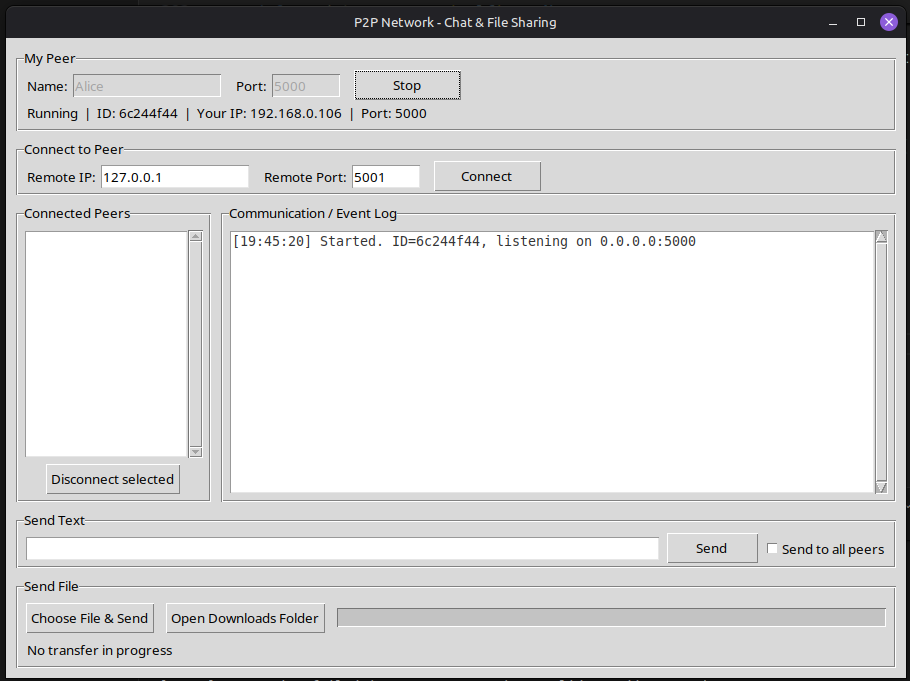
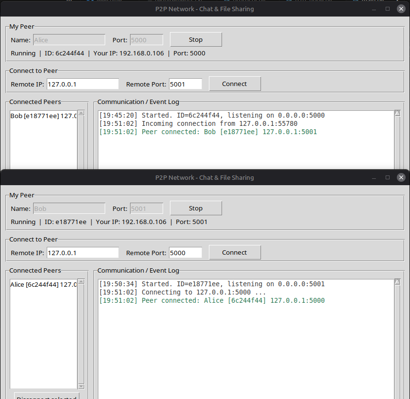
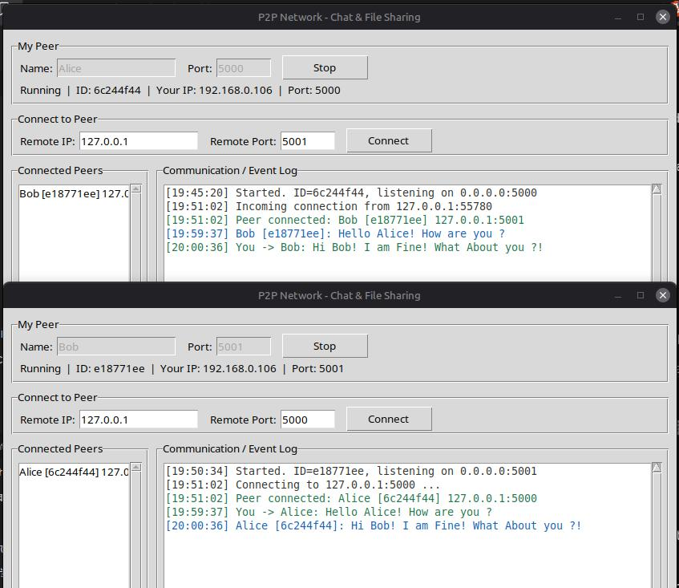
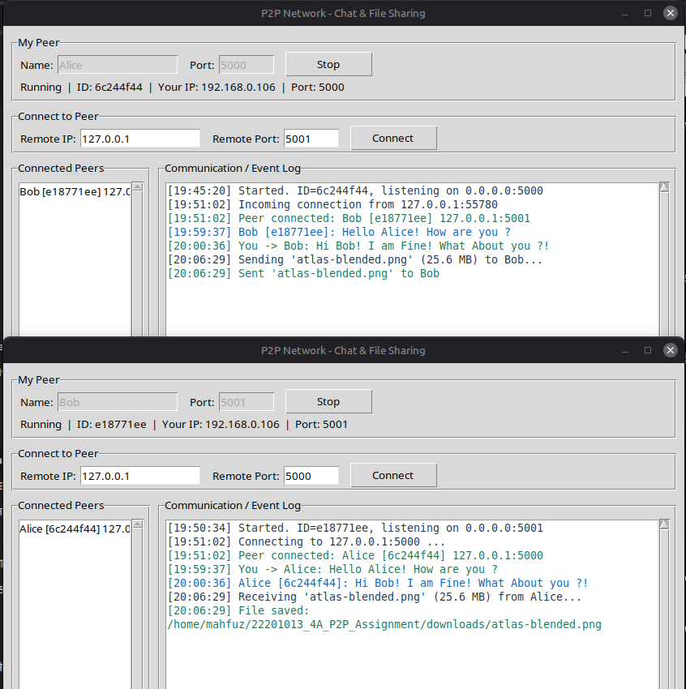
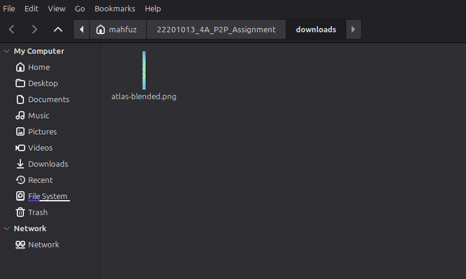
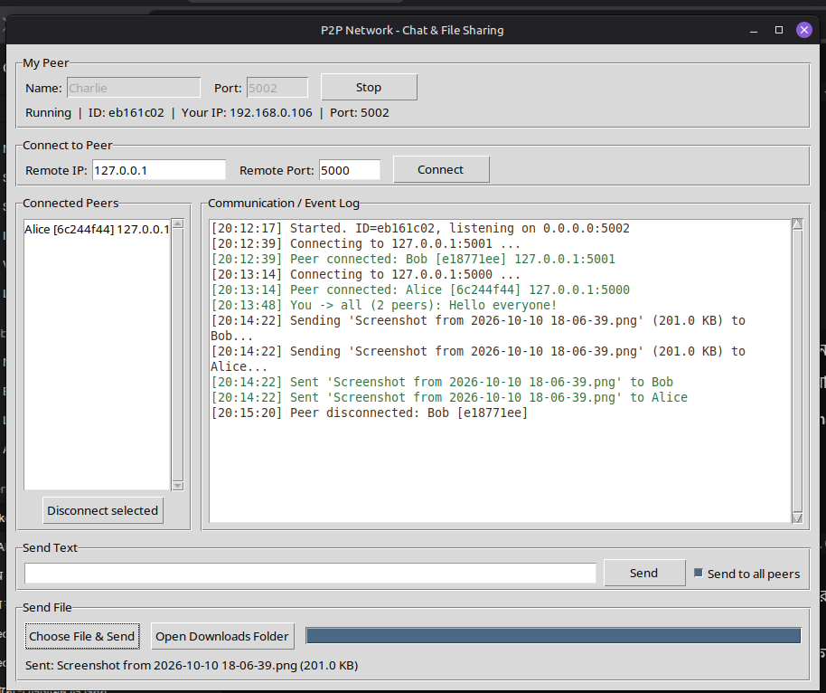

# P2P Network - Communication & File Sharing

**Course:** CSE 433: Blockchain & Distributed Security Lab  
**Institution:** University of Asia Pacific (UAP)  
**Student Name:** Md. Mahfuz Bhuiyan  
**Student ID:** 22201013  
**Section:** 4A  

---

## 1. Project Overview
This project implements a lightweight, decentralized Peer-to-Peer (P2P) network in Python using raw TCP sockets and multithreading. There is **no central server**; every node functions simultaneously as both a **TCP server** (listening for incoming connections on a bound port) and a **TCP client** (initiating outgoing connections to remote peers).

The system provides direct node-to-node text messaging, a two-way JSON handshake, and chunked binary file transfer supporting any format (images, videos, audio, PDFs, archives) without file corruption or RAM exhaustion. A graphical user interface (GUI) built with Tkinter is provided for real-time interaction.

---

## 2. Key Features
- **True Decentralized P2P Architecture:** Nodes communicate directly without intermediate relay servers.
- **Application-Level Framing:** Uses a 4-byte big-endian length prefix to preserve message boundaries over TCP byte streams.
- **Deterministic Handshake:** Automatic exchange of node identities (`hello` and `hello_ack`) upon connection.
- **Simultaneous Connection Resolution:** Resolves connection races between the same two peers using lexicographical `peer_id` comparison.
- **Chunked File Transfer:** Reads and streams files in 64 KB chunks, allowing transfer of arbitrary file sizes up to 4 GB with constant low memory usage.
- **Thread-Safe Tkinter GUI:** Decoupled network threads and UI updates using non-blocking FIFO queues (`queue.Queue`) and periodic polling.
- **Collision-Resistant Storage:** Received files are stored safely in the `downloads/` directory with automatic renaming (`filename (1).ext`) to prevent accidental overwrites.

---

## 3. System Requirements
- **Python Version:** Python 3.9 or newer (tested on Python 3.12)
- **Operating System:** Linux, Windows, or macOS
- **Dependencies:** None (exclusively uses Python standard library modules: `socket`, `threading`, `json`, `struct`, `tkinter`, `uuid`, `os`, `queue`, `re`)

---

## 4. Project Structure
```text
22201013_4A_P2P_Assignment/
├── downloads/                  # Received files are saved here
├── screenshots/                # Demonstration verification screenshots
│   ├── 01_peer_started.png
│   ├── 02_two_peers_connected.png
│   ├── 03_text_messages.png
│   ├── 04_file_transfer.png
│   ├── 05_downloads_folder.png
│   └── 06_three_peers.png
├── main.py                     # Tkinter graphical user interface
├── p2p_node.py                 # Core network engine (sockets, threads, peer manager)
├── protocol.py                 # Framing, JSON builders, raw byte streaming helpers
├── README.md                   # Complete documentation
└── requirements.txt            # Dependency declaration (standard library only)
```

---

## 5. How to Run the Application

Open a terminal inside the project root folder and run:
```bash
python3 main.py
```

### Starting a Peer
1. Enter your **Name** (e.g., `Alice`).
2. Enter your desired listening **Port** (e.g., `5000`).
3. Click **Start Peer**. The status bar displays your randomized Peer ID, listening port, and local LAN IP.

---

## 6. Connection & Usage Guide

### A. Testing on a Single Computer (Localhost)
1. **Terminal 1:** Run `python3 main.py` -> Name: `Alice`, Port: `5000` -> Click **Start Peer**.
2. **Terminal 2:** Run `python3 main.py` -> Name: `Bob`, Port: `5001` -> Click **Start Peer**.
3. On Bob's interface, enter the connection details under **Connect to Peer**:
   - **Remote IP:** `127.0.0.1`
   - **Remote Port:** `5000`
   - Click **Connect**.
4. Both peers complete the handshake and appear in each other's **Connected Peers** list.

### B. Testing Across Multiple Computers (Local Wi-Fi / LAN)
1. Connect all computers to the same local Wi-Fi or LAN subnet.
2. Start Peer on Computer A (note the local IP address on the status line, e.g., `192.168.0.106`).
3. On Computer B, enter Computer A's LAN IP under **Remote IP** and the port under **Remote Port**, then click **Connect**.

### C. Sending Text Messages
1. Select a peer from the **Connected Peers** list.
2. Type your message in the **Send Text** box.
3. Click **Send** or press `Enter`.
4. Tick **Send to all peers** to broadcast a message to everyone connected.

### D. Sending Files
1. Select the target peer from the list.
2. Click **Choose File & Send** and select any file from your computer.
3. The sender UI updates with a progress bar tracking transferred chunks.
4. The receiver saves the file directly into the `downloads/` directory.
5. Click **Open Downloads Folder** to view received items.

---

## 7. Protocol & Architecture Details

```text
+-------------------------------------------------------+
|                 User Interface (main.py)              |
+-------------------------------------------------------+
                           |
                           v
+-------------------------------------------------------+
|               P2P Engine (p2p_node.py)                |
|    - TCP Server (0.0.0.0:Port)  - TCP Client          |
|    - Accept Thread              - Receive Loops       |
|    - Peer Registry (ID -> Peer) - File Workers        |
+-------------------------------------------------------+
                           |
                           v
+-------------------------------------------------------+
|             Protocol Layer (protocol.py)              |
|    - Framing: [4-byte big-endian len][JSON payload]   |
|    - File Streaming: 64 KB Raw Binary Chunks          |
+-------------------------------------------------------+
                           |
                           v
+-------------------------------------------------------+
|                     OS TCP Sockets                    |
+-------------------------------------------------------+
```

### 1. Message Framing
TCP is a byte-stream protocol without built-in message boundaries. To prevent stream fragmentation and packet coalescing, all control messages and text packets are prefixed with a 4-byte big-endian unsigned integer indicating the length of the JSON payload:
```text
+-----------------------+---------------------------------------+
| 4-byte length prefix  | UTF-8 Encoded JSON Message Payload   |
+-----------------------+---------------------------------------+
```

### 2. Handshake Phase
```text
Node A (Initiator)                                Node B (Receiver)
       |                                                  |
       |--------------- TCP connect() ------------------->|
       |                                                  |
       |--- {"type": "hello", "peer_id": "...", ...} ---->|
       |                                                  |
       |<-- {"type": "hello_ack", "peer_id": ...} --------|
       |                                                  |
[Connected & Registered]                          [Connected & Registered]
```

### 3. File Transfer Sequence
1. **Metadata Phase:** The sender transmits a framed JSON message containing `filename` and `filesize`.
2. **Binary Stream Phase:** The sender streams the file content in chunks of 64 KB (`65536 bytes`).
3. **Receiving Phase:** The receiver reads exactly `filesize` bytes from the socket and writes them directly to disk, avoiding full-file buffering in memory.

---

## 8. Demonstration Screenshots

| Demonstration Milestone | Screenshot Reference |
|:---|:---:|
| **1. Peer Started:** Initialized node listening on port 5000 |  |
| **2. Two Peers Connected:** Handshake established between Alice and Bob |  |
| **3. Text Messaging:** Bi-directional messaging between connected peers |  |
| **4. File Transfer:** Chunked binary transfer showing progress and completion |  |
| **5. Received Files:** Output file stored securely in downloads directory |  |
| **6. Multi-Peer Network:** Charlie connected to both Alice and Bob simultaneously |  |

---

## 9. Error Handling
- **Port In Use:** Displays a clean error dialogue if the listening port is occupied.
- **Duplicate & Self Connections:** Blocks loops where a peer attempts to connect to itself or connect twice to the same endpoint.
- **Peer Disconnection:** Abrupt peer exits or closed connections are caught cleanly without terminating the application.
- **File System Protection:** Sanitizes incoming filenames to remove directory traversal characters (`../../`) and prevent file overwrites.

---

## 10. Automated Self-Tests
The project includes self-tests in the CLI for core networking and protocol functions:
```bash
# Protocol framing and JSON builder tests:
python3 protocol.py

# Handshake and basic connection error tests:
python3 p2p_node.py selftest

# Multi-peer concurrent race condition tests:
python3 p2p_node.py selftest4

# Text broadcast and ordering tests:
python3 p2p_node.py selftest5

# Chunked binary transfer and SHA-256 integrity tests:
python3 p2p_node.py selftest6
```